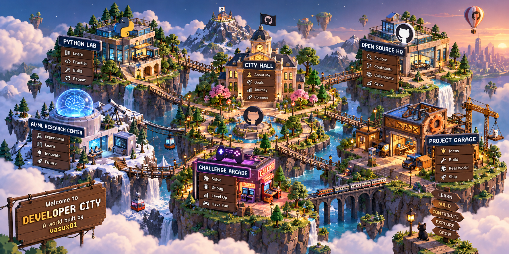

<div align="center">


</div>

---

# 🏙️ Welcome to Developer City

> Every developer starts with an empty plot. Every project builds something new.

Hey! I'm **Vedant Saini (`vasux01`)**, a beginner developer learning Python and exploring open source.

This is my digital city — a place where every building represents something I'm learning, building, or working towards.

## 🏡 MY DEVELOPER WORLD

<div align="center">



*Welcome to my little world of code. Every building represents something I'm learning or building.*

</div>

### 🗺️ Explore the World

| Destination | What's inside |
|---|---|
| 🐍 [Python Lab](#-python-lab) | Learning Python and practising coding |
| 🌍 [Open-Source HQ](#-open-source-hq) | Exploring repositories and contributions |
| 🔬 [AI Research Center](#-ai-research-center) | AI/ML interests and experiments |
| 🛠️ [Project Garage](#-project-garage) | Projects I'm building |
| 🎮 [Challenge Arcade](#-challenge-arcade) | Coding practice |
| 🏛️ [City Hall](#-city-hall) | About me and my goals |
</div>

---

## 🐍 PYTHON LAB

`BUILDING STATUS: LEARNING`

My programming journey starts here.

```python
class Developer:
    def __init__(self):
        self.name = "Vedant"
        self.language = "Python"
        self.status = "Learning"
        self.mission = "Build something useful"

    def next_step(self):
        return "Learn, practise, build, repeat."

me = Developer()
print(me.next_step())
```

Current objectives:

- [ ] Strengthen Python fundamentals
- [ ] Practise problem-solving
- [ ] Build a useful Python project
- [ ] Learn to write cleaner code

---

## 🌍 OPEN-SOURCE HQ

`BUILDING STATUS: EXPLORING`

The headquarters for learning how real-world software is built.

- 🔎 Explore repositories and understand their code
- 🐛 Learn how to report reproducible bugs
- 🔀 Understand branches, commits and pull requests
- 🤝 Work towards meaningful open-source contributions

**Mission:** Become a contributor, one step at a time.

---

## 🔬 AI RESEARCH CENTER

`BUILDING STATUS: FUTURE EXPANSION`

A place for future experiments in artificial intelligence and machine learning.

Planned research areas:

- 🤖 AI and machine learning fundamentals
- 📊 Data exploration
- 🧪 Small experiments and prototypes
- 🚀 Building projects as my knowledge grows

*Currently exploring — research projects will be added as I build them.*

---

## 🛠️ PROJECT GARAGE

`BUILDING STATUS: READY FOR NEW PROJECTS`

This is where ideas become real software.

<div align="center">

<a href="https://github.com/vasux01?tab=repositories">

</a>

</div>

### 🏗️ Projects under construction

| Project slot | Mission |
|---|---|
| 🚧 Project Alpha | My next Python project |
| 🚧 Project Beta | A tool that solves a real problem |
| 🚧 Project Gamma | An open-source contribution |

*These are planning slots, not completed projects. I'll replace them with real repository links as I build.*

---

## 🎮 CHALLENGE ARCADE

`BUILDING STATUS: LEVELING UP`

My practice zone for improving programming skills.

- 🧩 Solve coding problems
- 🐞 Debug broken programs
- 🧠 Learn new concepts
- ⚡ Turn small exercises into useful projects

**Current level:** Beginner

**Next level:** Build independently and contribute confidently.

---

## 📊 CITY STATISTICS

<div align="center">


<br/>


</div>

---

## 🏛️ CITY HALL

**Citizen:** Vedant Saini

**GitHub ID:** `vasux01`

**Currently learning:** Python and open source

**Interested in:** Software development and AI/ML

**City motto:** Build small. Learn constantly. Improve everything.

<div align="center">

<a href="https://github.com/vasux01">

</a>


<br/><br/>

`CITY STATUS: GROWING 🚀`

*The city is never finished. There's always another thing to build.*

</div>


